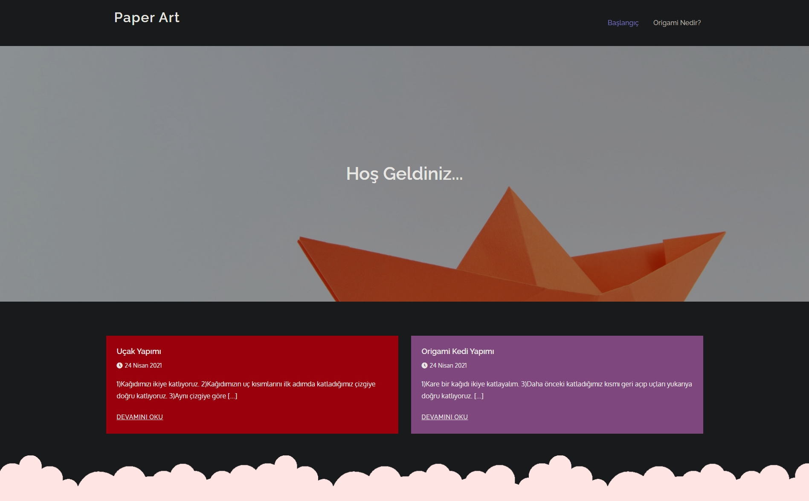
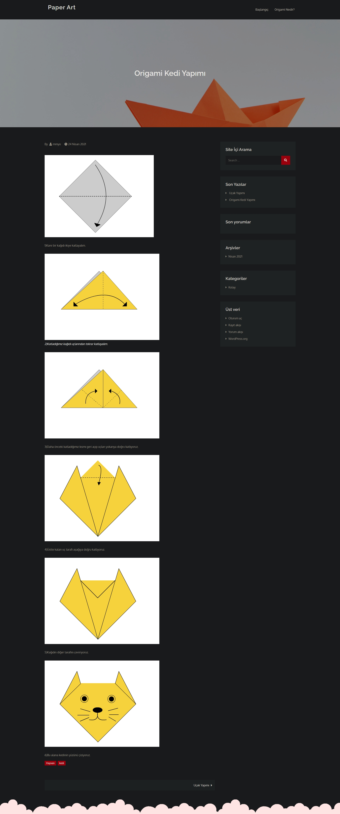
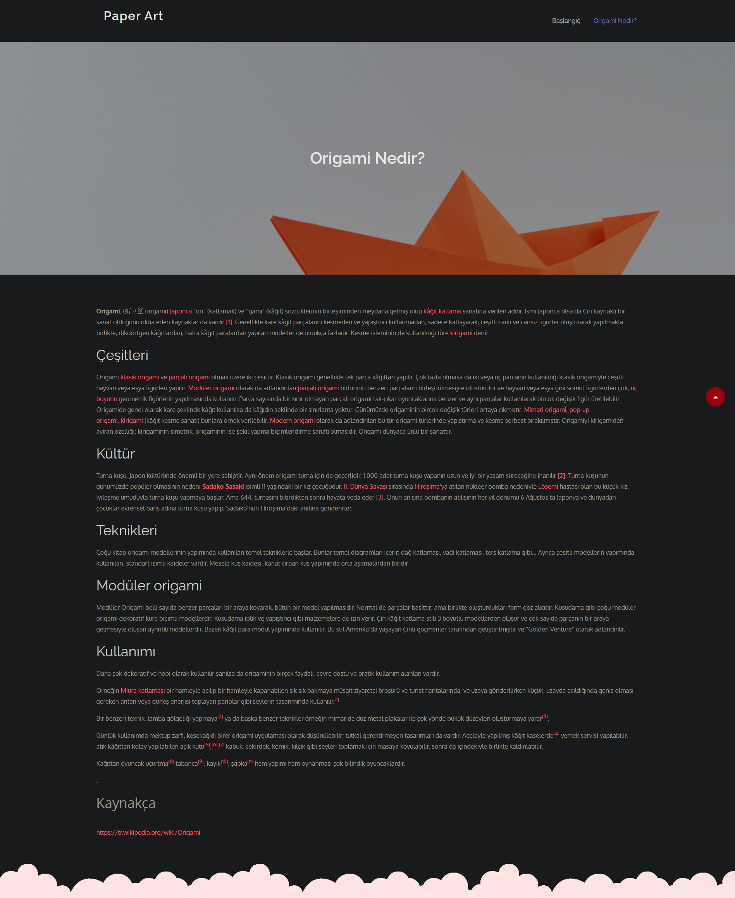

# Paper Art — Origami İçerik Sitesi

**Geliştirme tarihi: 13.06.2021**

Paper Art, ders kapsamında WordPress ve MySQL kullanarak geliştirdiğim, origami hakkında bilgi ve görsellerle desteklenen yapım adımları sunan bir web sitesi projesidir. Grand Academy temasını proje için özelleştirerek içerikleri, menüleri ve görselleri WordPress üzerinden düzenledim.



## Projede neler var?

- Origami hakkında bilgi veren **Origami Nedir?** sayfası.
- Görsellerle adım adım anlatılan **Origami Kedi Yapımı** ve **Uçak Yapımı** içerikleri.
- İçerik özetlerini listeleyen ana sayfa, gezinme menüsü, site içi arama ve yan panel bileşenleri.
- Özelleştirilmiş tema görünümü, başlık görseli ve Türkçe içerikler.
- Sayfaları, yazıları, menüleri, medya kayıtlarını ve tema ayarlarını içeren MySQL veritabanı dışa aktarımı.

## Çalışmamın kapsamı

Bu projede ders sırasında öğrendiğim WordPress kurulumu, hazır tema özelleştirme, içerik ve medya yönetimi konularını uyguladım. Tema dosyaları ve yönetim paneli ayarları üzerinde çalıştım; origami içeriklerini ve gezinme yapısını oluşturdum. İçeriklerin WordPress'in MySQL tablolarında tutulduğu yapıyı kullandım ve projeyi SQL yedeğiyle birlikte taşınabilir biçimde arşivledim.

Temanın temeli **Creativ Themes tarafından geliştirilen Grand Academy 1.7** sürümüdür. Bu depoda projede kullanılan özelleştirilmiş tema bulunur.

## Teknolojiler

| Teknoloji | Kullanımı |
| --- | --- |
| WordPress | İçerik yönetimi, sayfalar, yazılar, menüler ve medya |
| PHP | WordPress ve tema şablonları |
| MySQL | İçeriklerin ve site ayarlarının saklanması |
| HTML / CSS | Sayfa yapısı ve tema görünümü |
| JavaScript / jQuery | Temanın etkileşimleri |
| WampServer / localhost | Yerel geliştirme ortamı |

Arşivdeki WordPress sürümü **5.7.2**'dir. WordPress çekirdek dosyaları ayrıca kurulmalıdır. Projenin farklı WordPress ve PHP sürümleriyle uyumluluğu ayrıca test edilmelidir.

## Depo yapısı

```text
paperart/
├── README.md
├── .gitignore
├── database/
│   └── paperart.sql
├── docs/
│   └── screenshots/
│       ├── ana-sayfa.jpeg
│       ├── origami-kedi-yapimi.jpeg
│       └── origami-nedir.jpeg
└── wp-content/
    ├── themes/
    │   └── grand-academy/
    └── uploads/
        └── 2021/
            └── 04/
```

## Yerel kurulum

1. PHP ve MySQL çalıştırabilen bir yerel ortam hazırlayın. WordPress dosyalarını web sunucunuzun `paperart` klasörüne yerleştirin. Aşağıdaki adımlar `http://localhost/paperart` adresini esas alır.
2. MySQL'de bu proje için **boş bir veritabanı** oluşturun. phpMyAdmin'in **İçe aktar** bölümünden `database/paperart.sql` dosyasını bu veritabanına aktarın.
3. WordPress'in `wp-config-sample.php` dosyasından yerel `wp-config.php` dosyanızı oluşturun. `DB_NAME`, `DB_USER`, `DB_PASSWORD` ve `DB_HOST` değerlerini kendi ortamınıza göre doldurun ve güvenlik anahtarlarını kendiniz oluşturun.
4. Aynı dosyada tablo önekini **`$table_prefix = 'cba_';`** olarak ayarlayın. İçe aktarılan tablolar bu öneki kullanır; yeni bir WordPress kurulumu başlatarak mevcut içeriği değiştirmeyin.
5. Bu depodaki `wp-content/themes/grand-academy/` klasörünü WordPress'in aynı konumuna kopyalayın. `wp-content/uploads/2021/04/` klasörünü de aynı dizin yapısını koruyarak kopyalayın. Görsellerin dosyaları SQL'in içinde bulunmaz.
6. `http://localhost/paperart` adresini açın. Veritabanında seçili tema `grand-academy` olarak kayıtlıdır. İçerikleri görüntülemek için yönetici girişi gerekmez.
7. Yönetim panelini kullanmak için temizlenmiş `demo-author` hesabına **kendi yerel parolanızı** tanımlayın. WP-CLI kuruluysa WordPress dizininde aşağıdaki komut parolayı etkileşimli olarak sorar:

   ```bash
   wp user update demo-author --prompt=user_pass --skip-plugins --skip-themes
   ```

8. Giriş yaptıktan sonra gerekirse **Ayarlar → Kalıcı bağlantılar** sayfasını kaydedin. Yedekte kayıtlı taşıma/yedekleme eklentileri bu depoya dahil değildir; origami içeriklerini görüntülemek için bu eklentilere ihtiyaç yoktur.

Farklı bir adres kullanacaksanız `siteurl`, `home` ve içeriklerdeki eski adreslerin güncellenmesi gerekir. WordPress ayarları serileştirilmiş veri içerebildiği için SQL dosyasında düz metin değişimi yerine serileştirilmiş veriyi koruyan bir taşıma yöntemi kullanın.

## Veritabanı hakkında

Paylaşılan SQL, **24.04.2021 tarihli içerik yedeğinin temizlenmiş kopyasıdır**. Projenin geliştirme tarihi 13.06.2021'dir; içerik yedeğinin tarihi ayrıdır.

Sayfalar, yazılar, menüler, tema ayarları ve **23 medya kaydı** korunmuştur. Kullanıcı kimliği ve bağlantıları korunarak hesap örnek bir yazar hesabına dönüştürülmüş; kişisel e-posta, eski parola özeti, oturum verileri ve yedekleme kimlik bilgileri temizlenmiştir. Bu nedenle paylaşımda kullanılabilir bir yönetici parolası bulunmaz.

## Diğer ekran görüntüleri

Ekran görüntüleri, projenin 27.10.2026 tarihinde localhost üzerinde görüntülenen halini gösterir.

<details>
<summary>Origami Kedi Yapımı</summary>



</details>

<details>
<summary>Origami Nedir?</summary>



</details>

## Kaynaklar ve atıflar

- **Grand Academy — Creativ Themes:** Temanın lisans ve üçüncü taraf kaynak bilgileri [tema readme dosyasında](wp-content/themes/grand-academy/readme.txt) korunmuştur. Tema, bu dosyada GPLv2 veya sonrası olarak belirtilmiştir.
- **Origami Nedir?** içeriğinin kaynakçasında [Türkçe Vikipedi — Origami](https://tr.wikipedia.org/wiki/Origami) yer alır.
- Kullanılan hazır tema, kütüphaneler ve üçüncü taraf içeriklerin atıfları ilgili dosyalarda ve sayfalarda bulunur. Tema uyarlaması ve site düzenlemesi bu ders projesi kapsamındaki çalışmamdır.
